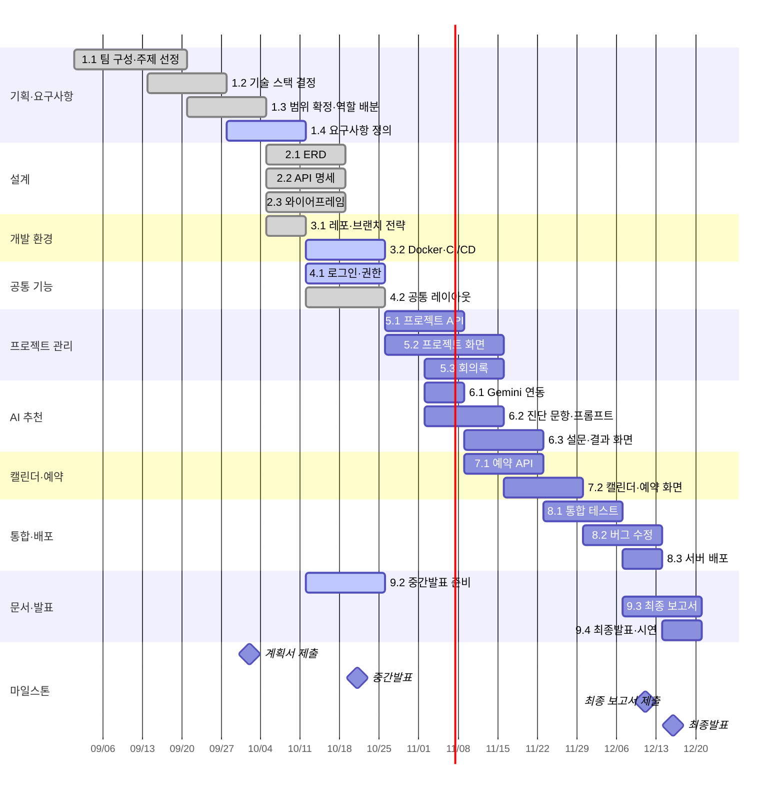
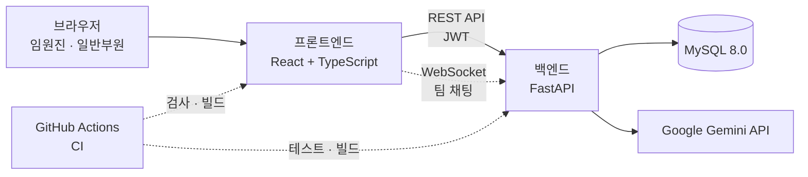

# CERT-IS 통합 관리 시스템

[](https://github.com/Opal1031/PKNU_SE_CERT-IS_Scheduler/actions/workflows/ci.yml)

국립부경대학교 소프트웨어공학(105) 4조 팀 프로젝트입니다.
교내 정보보안동아리 **CERT-IS**의 프로젝트·스터디 관리, 회의록, 동아리방 예약, 일정, 팀 채팅을 하나의 웹 서비스로 통합하고, 신입부원에게 AI로 맞는 보안 분야를 추천합니다.

## 문제 정의

CERT-IS는 공지는 카카오톡, 스터디·프로젝트는 Notion으로 나누어 운영하고 있어 다음과 같은 불편이 있습니다.

- 프로젝트 현황을 Notion 페이지로만 관리하며, 공유 페이지 오류(블록 삭제 불가 등)가 발생합니다.
- 동아리방 예약을 구두나 카카오톡으로 협의합니다.
- 캘린더가 없어 일정을 확인하려면 공지를 일일이 찾아봐야 합니다.
- 카카오톡에서 결정한 내용을 Notion에 다시 정리해야 합니다.
- 신입부원이 자신에게 맞는 보안 분야를 알기 어려워 프로젝트·스터디 참여 결정이 늦어집니다.

## 목표

| 대상 | 제공하는 것 |
|---|---|
| 임원진 | 프로젝트·스터디를 통일된 양식으로 등록·관리하고, 동아리방 예약과 동아리 일정을 통합 캘린더 한 곳에서 확인 |
| 일반부원 | 진행 중인 활동을 프로젝트·스터디 페이지와 캘린더에서 한눈에 확인하고, AI 추천으로 자신에게 맞는 보안 분야 선택 |
| 공통 | 카카오톡·Discord·Notion으로 나뉜 회의와 정리를 시스템 안의 회의록과 채팅으로 처리 |

## 주요 기능과 진행 상황

2026-10-20(8주차) 기준입니다. 프론트엔드 화면은 서버 연결 전까지 브라우저 저장소(localStorage) 데모 데이터로 동작합니다.

| 기능 | 내용 | 프론트엔드 | 백엔드 |
|---|---|---|---|
| 로그인·권한 관리 | 로그인, 임원진/일반부원 구분, 활동별 팀장·팀원 권한 | 화면 완료 (데모 로그인) | ✅ API 완료 |
| 프로젝트·스터디 관리 | 등록·조회·수정, 담당자·상태·보안 분야 필터, 참가 신청 | 화면 완료 | 조회 API 완료, 등록·수정·필터 예정 |
| 회의록 | 활동별 Markdown 회의록 작성·조회, 버전 이력 | 화면 완료 | 예정 |
| AI 보안 분야 추천 | 15문항 진단 응답을 Gemini API로 분석해 분야·학습 방향 제시 | 설문·점수 계산 화면 완료 | Gemini 연동 예정 |
| 동아리방 예약 | 30분 단위 예약, 중복 자동 차단, 예약 현황판 | 화면 완료 | DB 설계 완료, API 예정 |
| 통합 캘린더 | 동아리·프로젝트 일정과 동아리방 예약 현황 | 화면 완료 | 예정 |
| 팀 채팅 | 프로젝트·스터디 채팅방, 실시간 메시지 송수신 | 화면 완료 | 예정 (WebSocket) |

## 프로젝트 범위

| 구현할 것 | 구현하지 않을 것 |
|---|---|
| 로그인 및 권한 관리(임원진 / 일반부원) | 모바일 애플리케이션 (반응형 웹으로 대체) |
| 프로젝트·스터디 등록 / 조회 / 수정 | 외부 캘린더(Google, Notion) 연동 |
| 프로젝트·스터디 팀 채팅 | 회비·결제 관리 |
| 담당자·상태·보안 분야 기준 필터링 | 자체 AI 모델 학습 (Gemini API 호출만 사용) |
| 회의록 Markdown 작성 | |
| 동아리 일정·프로젝트 일정·예약 통합 캘린더 | |

## 개발 일정 (WBS)

2026.09.01 ~ 12.20, 16주. 빨간 선이 오늘입니다. 회색은 완료, 연한 색은 진행 중입니다.



| WBS | 작업 | 담당 | 주차 | 상태 | 산출물 |
|---|---|---|---|---|---|
| 1.1 | 팀 구성·주제 선정 | 전체 | 1–3 | ✅ 완료 | |
| 1.2 | 기술 스택 조사·결정 | 전체 | 3–4 | ✅ 완료 | React · FastAPI · MySQL |
| 1.3 | 주제·범위 확정, 역할 배분 | 전체 | 4–5 | ✅ 완료 | 프로젝트 계획서 (10/2 제출) |
| 1.4 | 요구사항 정의 | PM | 5–6 | 🔄 진행 중 | 요구사항 명세서 |
| 2.1 | DB 설계 (ERD) | BE | 6–7 | ✅ 완료 | [ERD](docs/backend/ERD.md) |
| 2.2 | API 명세 설계 | BE | 6–7 | ✅ 완료 | [API 명세](docs/backend/API.md) |
| 2.3 | 화면 설계 (와이어프레임) | FE | 6–7 | ✅ 완료 | [화면별 작업트리](docs/frontend/화면별_작업트리.md) |
| 3.1 | GitHub 레포·브랜치 전략 | BE | 6 | ✅ 완료 | [협업 규칙](CONTRIBUTING.md), 이슈·PR 템플릿, 라벨 |
| 3.2 | Docker·GitHub Actions CI/CD | BE | 7–8 | 🔄 진행 중 | CI 완료, Vercel 자동 배포(프론트·백엔드), Aiven MySQL |
| 4.1 | 로그인·권한 관리 | BE | 7–8 | 🔄 진행 중 | API 완료, 화면 연동 남음 |
| 4.2 | 공통 레이아웃 | FE | 7–8 | ✅ 완료 | `frontend/src/App.tsx` |
| 5.1 | 프로젝트 등록·조회·필터 API | PM | 9–10 | ⏳ 예정 | 조회 API 일부 선구현 |
| 5.2 | 프로젝트 목록·상세 화면 | FE | 9–11 | ⏳ 예정 | 화면 선구현 (로컬 데모) |
| 5.3 | 회의록 등록·조회 | PM | 10–11 | ⏳ 예정 | 화면 선구현 (로컬 데모) |
| 6.1 | Gemini API 연동 | AI | 10 | ⏳ 예정 | |
| 6.2 | 진단 문항·프롬프트 작성 | AI | 10–11 | ⏳ 예정 | [문항·가중치 초안](docs/recommend/architecture.md) |
| 6.3 | 설문·결과 화면 | AI | 11–12 | ⏳ 예정 | 화면 선구현 (로컬 데모) |
| 7.1 | 예약 API (중복 방지) | BE | 11–12 | ⏳ 예정 | DB 설계 완료 (UNIQUE 제약 + 트랜잭션) |
| 7.2 | 캘린더·예약 현황 화면 | FE | 12–13 | ⏳ 예정 | 화면 선구현 (로컬 데모) |
| 8.1 | 기능 통합 및 테스트 | 전체 | 13–14 | ⏳ 예정 | |
| 8.2 | 버그 수정 | 전체 | 14–15 | ⏳ 예정 | |
| 8.3 | 서버 배포 | BE | 15 | ⏳ 예정 | 배포 URL |
| 9.1 | 주간 회의록 작성 | PM | 1–16 | 🔄 진행 중 | 주 1회 |
| 9.2 | 중간발표 자료 준비·발표 | PM | 7–8 | 🔄 진행 중 | 중간발표 자료 |
| 9.3 | 최종 보고서 작성 | PM | 15–16 | ⏳ 예정 | 최종 보고서 (12/11 제출) |
| 9.4 | 최종발표·시연 준비 | PM | 16 | ⏳ 예정 | 발표 자료·시연 (12/16) |

## 팀

| 역할 | 이름 | 담당 |
|---|---|---|
| PM | 장기태 | 일정 관리, 회의 주재, 요구사항 정의, 프로젝트 관리 및 회의록, 중간·최종 발표 |
| 백엔드·배포 | 김민서 | DB·API 설계, 로그인·권한, 동아리방 예약, Docker·GitHub Actions CI/CD, 서버 배포 |
| 프론트엔드 | 조연우 | 웹 페이지 설계, 공통 레이아웃, 메인·프로젝트·캘린더·예약·채팅 화면 |
| AI | 장혜림 | Gemini API 연동, 보안 분야 진단 문항·프롬프트, 추천 화면 |

담당자가 부재할 때는 장기태–김민서, 조연우–장혜림이 짝을 이루어 서로의 업무를 대신합니다.

## 기술 스택

| 구분 | 사용 기술 |
|---|---|
| 프론트엔드 | React, TypeScript, Tailwind CSS, Vite |
| 백엔드 | Python, FastAPI (REST · WebSocket), SQLAlchemy |
| DB | MySQL 8.0 |
| 인증 | JWT |
| AI | Google Gemini API |
| 배포·CI | Docker, Docker Compose, GitHub Actions |



## 폴더 구조

```text
.
├─ frontend/             React 앱 (화면·로컬 데모 데이터·운영 규칙 테스트)
├─ backend/              FastAPI 서버 (인증·권한·모델·테스트)
├─ docs/
│  ├─ frontend/          화면 설계 기록, 화면별 작업트리, 화면 캡처
│  ├─ backend/           ERD, API 명세
│  └─ recommend/         AI 설문 문항·분야 가중치
├─ assets/               로고
├─ docker-compose.yml    MySQL + 백엔드 API 로컬 실행
├─ vercel.json           Vercel 배포 설정 (프론트엔드·백엔드 Services)
├─ .github/              CI 워크플로, 이슈·PR 템플릿
└─ CONTRIBUTING.md       브랜치·PR·커밋 규칙
```

## 실행 방법

### 백엔드 (MySQL 포함)

Docker가 필요합니다.

```bash
docker compose up --build
```

API 문서(Swagger): http://127.0.0.1:8000/docs

샘플 계정은 `admin`(임원진), `gitae`·`minseo`·`hyelim`·`yeonwoo`(일반부원)이고 비밀번호는 `certis1234!`입니다. Python만으로 실행하는 방법과 테스트는 [backend/README.md](backend/README.md)에 있습니다.

### 프론트엔드

Node.js 22.18 이상, pnpm 11이 필요합니다.

```bash
cd frontend
pnpm install
pnpm dev
```

주소: http://127.0.0.1:8765/#/dashboard

검사·빌드 방법과 코드 위치는 [frontend/README.md](frontend/README.md)에 있습니다.

### 배포

주소: https://cert-is.vercel.app (API 문서: https://cert-is.vercel.app/docs)

- **구성:** Vercel 한 프로젝트에 프론트엔드와 백엔드를 함께 올립니다([vercel.json](vercel.json)의 Services 설정). `/api/…`, `/docs`는 FastAPI 백엔드로, 나머지 주소는 React 앱으로 연결되어 같은 주소를 쓰므로 CORS 설정이 필요 없습니다.
- **DB:** Aiven 무료 MySQL을 사용합니다. 한동안 쓰지 않으면 꺼질 수 있으며, Aiven 콘솔에서 다시 켭니다.
- **자동 배포:** `main`에 merge되면 운영 주소에, PR마다 미리보기 주소에 배포됩니다. 백엔드는 빌드할 때 `python -m app.seed`로 테이블과 샘플 계정을 만듭니다(이미 있으면 건너뜀).
- **환경 변수(Vercel):** `DATABASE_URL`(Aiven Service URI, DB 이름 `certis`), `DATABASE_SSL_CA`(Aiven CA 인증서), `JWT_SECRET`, `APP_ENV=production`. 자세한 내용은 [backend/README.md](backend/README.md#배포-vercel--aiven)에 있습니다.

## 협업 방식

- `main`에는 PR로만 합치고, 작업은 `feature/…`, `fix/…`, `docs/…` 브랜치에서 진행합니다. 자세한 규칙은 [CONTRIBUTING.md](CONTRIBUTING.md)에 있습니다.
- 이슈는 템플릿(버그, FE, BE, AI, 리팩터링, 실행 환경)으로 작성하며, 영역(`fe` `be` `ai`)과 유형(`feat` `bug` `refac` `documentation` `environment`) 라벨을 붙입니다.
- PR마다 GitHub Actions가 백엔드 테스트(SQLite·MySQL 8.0), 프론트엔드 타입 검사·테스트·빌드, 백엔드 도커 이미지 빌드를 실행합니다.

## 문서

| 문서 | 내용 |
|---|---|
| [docs/backend/ERD.md](docs/backend/ERD.md) | DB 테이블과 관계, 설계 결정 |
| [docs/backend/API.md](docs/backend/API.md) | API 목록, 권한표, 요청·응답 예시 |
| [docs/frontend/화면별_작업트리.md](docs/frontend/화면별_작업트리.md) | 화면 구성과 구현 범위 |
| [docs/frontend/CERT-IS_통합_관리_시스템_상세_설계_기록.md](docs/frontend/CERT-IS_통합_관리_시스템_상세_설계_기록.md) | 화면·기능 상세 설계 기록 |
| [docs/recommend/architecture.md](docs/recommend/architecture.md) | AI 설문 문항과 분야 가중치 |

## 라이선스

[MIT](LICENSE)
