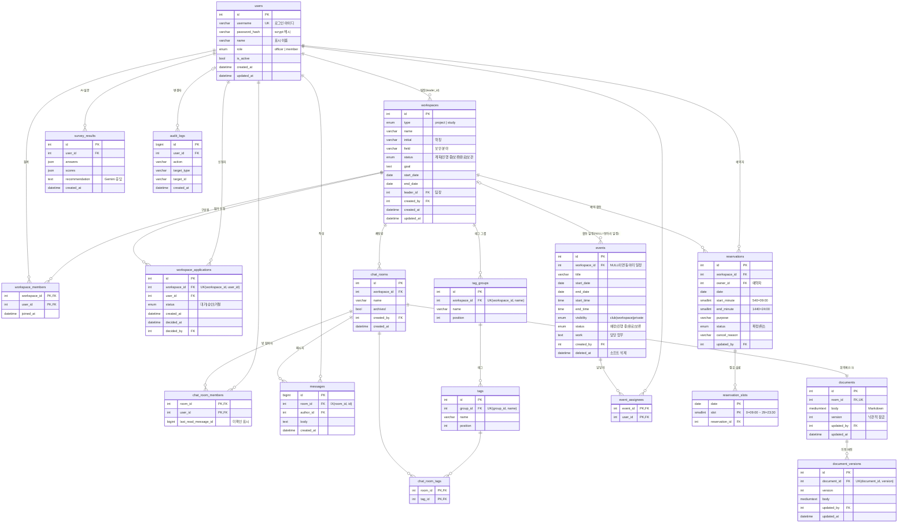

# CERT-IS DB 설계 (ERD)

WBS 2.1 산출물. MySQL 8.0 기준이며 실제 테이블은 `backend/app/models/`의 SQLAlchemy 모델에서 만들어진다.
프론트엔드 `frontend/src/model.ts`의 자료 구조(Workspace, Room, Event, Booking, TagGroup, Document)를 기준으로 설계했다.

## 1. 전체 관계도

아래 Mermaid 코드는 GitHub에서 바로 그림으로 보이며, 같은 그림을 [erd.png](erd.png)로도 저장해 두었다.

## 2. 설계 결정

| 결정 | 이유 |
|---|---|
| 프로젝트·스터디를 `workspaces` 한 테이블(`type`)로 관리 | 두 유형의 화면·기능이 같다(프론트 `Workspace` 타입과 동일). |
| 동아리 역할(`users.role`)과 활동 역할(`leader_id`, `workspace_members`) 분리 | 임원 여부와 팀장 여부는 서로 독립이다. 한 사람이 여러 활동의 팀장일 수 있다. |
| 팀장은 반드시 구성원에도 포함 | 구성원에서 빠지면 `leader_id`가 남아 있어도 팀장 권한이 없다(`permissions.is_leader`). |
| 회의록 `documents`는 채팅방과 1:1, `version` 컬럼 | 저장 시 `baseVersion`이 현재 `version`과 다르면 거부해 다른 사람의 저장을 덮어쓰지 않는다. 이전 본문은 `document_versions`에 남긴다. |
| 동아리 일정은 `events.workspace_id = NULL` + `visibility = 'club'` | 동아리 일정과 활동 일정을 한 캘린더 조회로 모은다. 이 규칙은 API에서 검사한다(MySQL은 ON DELETE 동작이 걸린 외래 키 컬럼을 CHECK에 쓸 수 없음). |
| 예약 시간을 분 단위 정수(`start_minute`, `end_minute`)로 저장 | 24:00 종료를 TIME 타입·파이썬 `time`으로 표현하기 어렵다. 30분 단위·운영 시간(09:00~24:00)은 CHECK와 API에서 검사한다. |
| `reservation_slots`의 기본키 `(date, slot)` | 예약 1건이 차지하는 30분 칸마다 행을 넣는다. 같은 칸을 두 예약이 넣으려 하면 기본키 중복으로 DB가 거부하므로, 동시에 신청해도 한 건만 확정된다(WBS 7.1 "UNIQUE 제약 + 트랜잭션"). 취소 시 슬롯 행만 지우고 예약 행은 기록으로 남긴다. |
| 예약을 일정 테이블에 복사하지 않음 | 캘린더 조회 시 예약을 함께 읽어 표시한다. 변경·취소 때 두 자료가 어긋나지 않는다(프론트 `calendarEvents`와 같은 방식). |
| 많이 쌓이는 `messages`, `audit_logs`는 BIGINT ID | 채팅 메시지가 INT 범위를 넘을 가능성에 대비한다. |
| 문자 집합 `utf8mb4` | 한글·이모지 저장. `docker-compose.yml`과 접속 URL에 지정. |

## 3. 아직 정하지 않은 부분

- 캘린더 개인 즐겨찾기(핀)는 지금처럼 브라우저 저장을 유지하고, 서버 저장이 필요해지면 `calendar_pins(user_id, target)`를 추가한다.
- 활동 `field` 값 목록은 활동(웹 보안·네트워크·암호학·시스템 보안)과 AI 설문(웹·리버싱·시스템·포렌식·암호학) 분류가 달라 API에서 허용 목록으로 관리한다.
- 마이그레이션 도구(Alembic)는 테이블 구조가 안정되면 도입한다. 지금은 `python -m app.seed`가 `create_all`로 테이블을 만든다.
